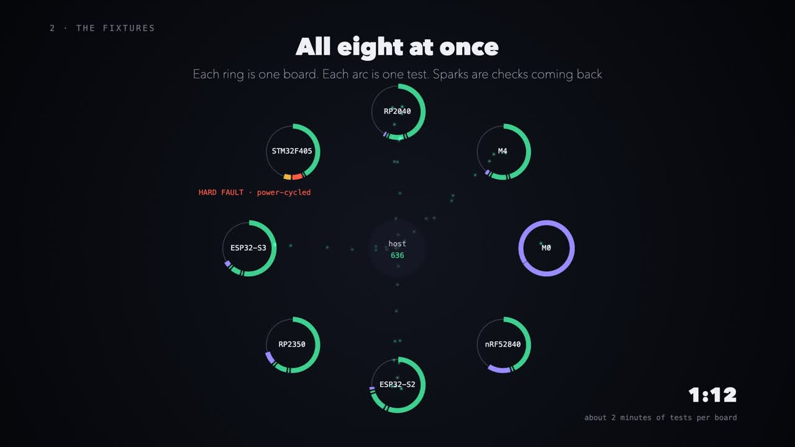
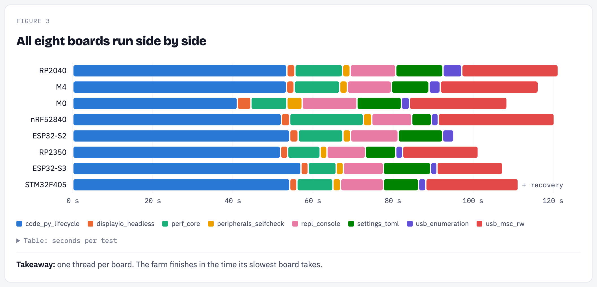
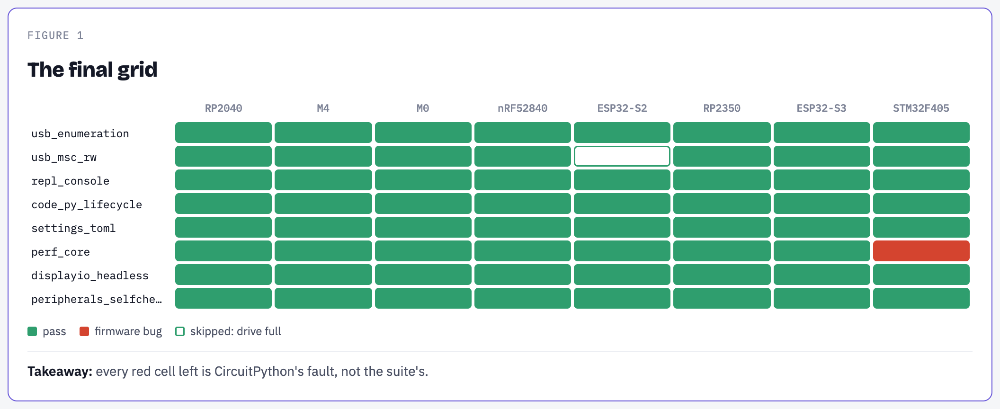
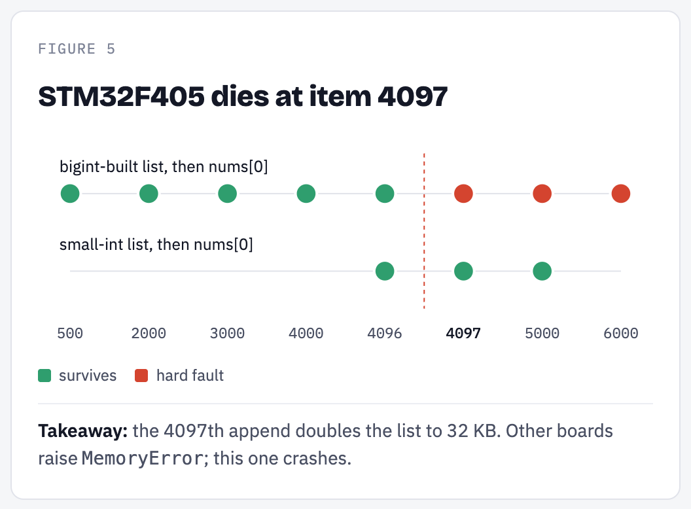
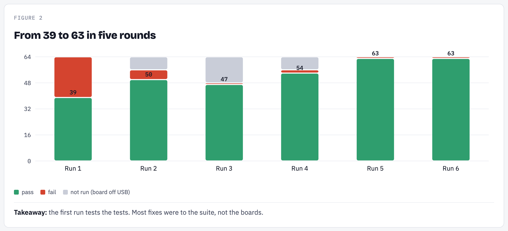
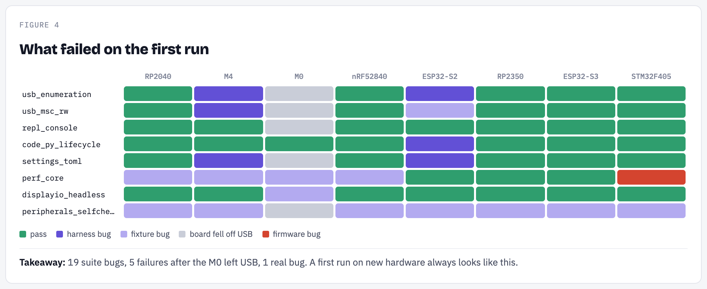
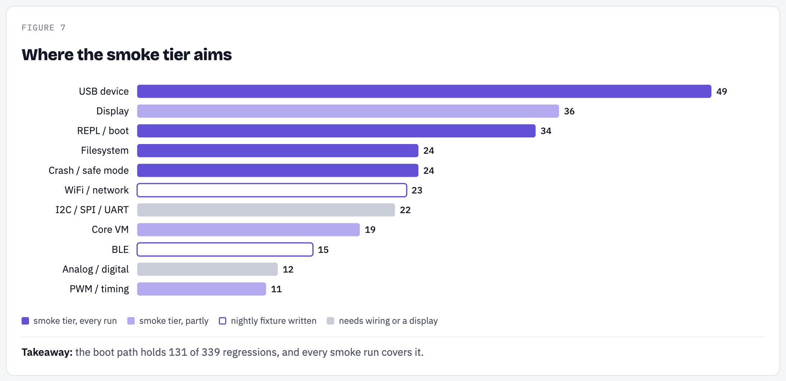
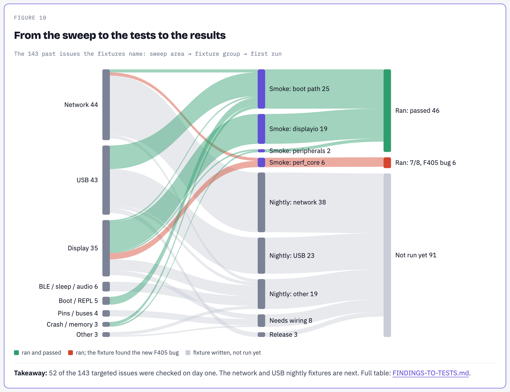

# cp-regress

Automatic checks for CircuitPython on real boards.

[](https://mikeysklar.github.io/cp-regress/media/cp-regress-story.mp4)

*Click to play: 2:36, music, no voice. A shorter run-only cut is [here](https://mikeysklar.github.io/cp-regress/media/cp-regress-first-run.mp4).*

**[See the first-run results page →](https://claude.ai/artifact/HB8Lj4rmAnzNZhMCkiKWX3)**

## Why

New CircuitPython releases sometimes break things that used to work. Today, users find those bugs, about a week later.

## What

Eight real boards on a pegboard. After each code change, a script tries the basics on all eight and reports.

## How

Plug in, copy files, open the console, run code. Like a person would, but automatically, in minutes, every time.



## Tested

CircuitPython main from 13 Oct 2026 (11.0.0-alpha.1). Eight boards, five chip families, 1,075 checks per run.

## First run

63 of 64 tests passed. The one failure is a real bug: one board crashes when a list grows.





## Getting there

The first run mostly found bugs in the tests themselves. Five rounds of fixes took it from 39 to 63.





## What it covers

The startup path (USB, drive, console, code.py) is where most past breakage happened. Every run checks it.



## Research to results

Each test exists because of past bugs. This traces every one, from the research to its result.



Full table: [docs/FINDINGS-TO-TESTS.md](docs/FINDINGS-TO-TESTS.md), rebuilt by `tools/trace.py`.

## Run it

```sh
python3 run.py --tier smoke
```

Details: [docs/USAGE.md](docs/USAGE.md), [docs/FIRST-RUN.md](docs/FIRST-RUN.md), [CONTRACT.md](CONTRACT.md), [docs/fixtures/](docs/fixtures/).

## Or with pytest

Same tests, same boards, pytest style. Every check is its own test.

```sh
pytest -n 8 --dist loadgroup test/
```

Details: [docs/PYTEST.md](docs/PYTEST.md).
